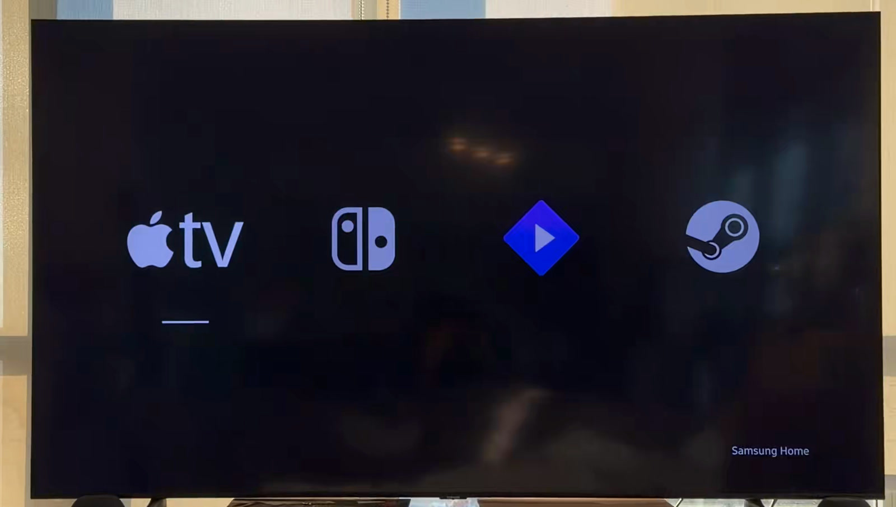

# Four

An offline Samsung TV home with shortcuts to your HDMI devices and installed
apps. An agent gathers the TV's inventory, resolves device names and app IDs,
finds local logos, and prepares a private build with 1-8 shortcuts.
Samsung Home remains available through a separate button.

**Experimental, tested on one TV:** QN65Q70TAFXZC, Tizen 5.5.0,
firmware T-NKMAKUC-2743.0. The installed version is 0.2.2. The configurable
setup workflow still needs a real-TV test.

The owner confirmed that short Home on the Samsung remote opens Four without
Samsung's Home bar, and that navigation and opening Apple TV felt very fast.
The Home route survived one long-Power restart. Both recorded power tests
required a Home press to open Four; automatic startup remains unresolved.
There is no measured before/after speedup. No Samsung package was disabled or
uninstalled. See the [cleanup results](docs/debloat.md) and
[performance measurements](docs/performance.md).



Four 0.2.2 on the owner's Q70T, photographed on 7 November 2026. This frame was
cropped from the owner's video; the TV interface is unchanged. These four
destinations are an example, not a required configuration. A separate
[browser preview](docs/preview.png) shows the same original layout.

## Set up your home

Agents should read [AGENTS.md](AGENTS.md) and follow the
[setup workflow](docs/agent-setup.md). It covers discovery, missing names,
local artwork, signing and real-device checks.

Discovery needs an authorized Samsung Web Inspector session, an existing
inventory, or accessible TV Sources and installed-app information. The public
source API on the tested Q70T returns HDMI numbers without saved names. An
existing native-name export or the TV's Sources screen must fill that gap.
The repository does not provide a bootstrap installer or a supported native-name
collector. Unknown destinations stay unresolved instead of inheriting the
original owner's settings.

After saving the observed inventory as `.local/inventory.json`, generate a plan:

```sh
python3 tools/setup-home.py \
  --inventory .local/inventory.json --out .local/home.json
```

This includes HDMI sources, including disconnected devices. Add
`--apps Stremio Netflix` to request those installed apps, or `--exclude-ports 1`
to omit a port.
The command exits with code 2 until names, app matches, logos and the shortcut
count are resolved. Keep supporting evidence and any exclusions privately.

Stage the completed plan and preview it:

```sh
python3 tools/stage-app.py --home .local/home.json --out .local/stage
python3 -m http.server 4796 --bind 127.0.0.1 --directory .local/stage
```

Open `http://127.0.0.1:4796` and use arrows, Enter and Escape. Check the owner's
destinations before packaging. A browser cannot switch TV inputs, launch TV
apps or verify physical remote behavior. The app has no runtime dependencies,
network permission, remote assets, background services, polling or animations.

Build and sign the staged directory with Samsung's official Tizen tools and an
owner-controlled TV Public certificate profile containing the target TV's DUID.
The current app identity is `Q70Home001.Home`; check for a collision before
installing. Keep inventories, home configurations, downloaded assets, source
exports, signing material, device records and packages under `.local/`, outside
Git. Verify every shortcut on the TV after installation.

The older `--inputs` staging option remains available for the original four
destinations. It requires a native source export and the exact tested model and
firmware. See the [setup workflow](docs/agent-setup.md) for its limits.

## Physical Home and recovery

The dashboard alone does not replace the physical Home button. The separate
source-built [native companion](native/Route.cs) and
[offline package builder](tools/home-route.py) implement the tested Q70T route.
They use an undocumented Samsung manifest extension and require an independently
captured baseline, the exact supported firmware and tested recovery.
The builder does not connect to a TV. A supported baseline collector is not
provided. Follow [Home routing and recovery](docs/home-route.md) before changing
the route, and preserve a working route during ordinary home customization.

Keep the signed stock-restore package. Never uninstall an active Home-route
carrier. The Apple TV remote's Home button may be handled by Apple TV itself;
its behavior is not established by the Samsung remote test.

## Development

```sh
node --test tests/*.test.cjs
python3 -m unittest discover -s tests -p 'test_*.py' -v
```

This project is separate from CleanYourTV's Android launcher. It includes no
Samsung package-disable list, root method, vendor-service modification or
resident Home watcher. Any upstream contribution follows CleanYourTV's showcase
workflow and reports only verified results. Do not publish private baselines.

Licensed under MIT. Device and service names identify destinations; this project
has no affiliation with Samsung, Apple, Nintendo, Stremio or Valve.
