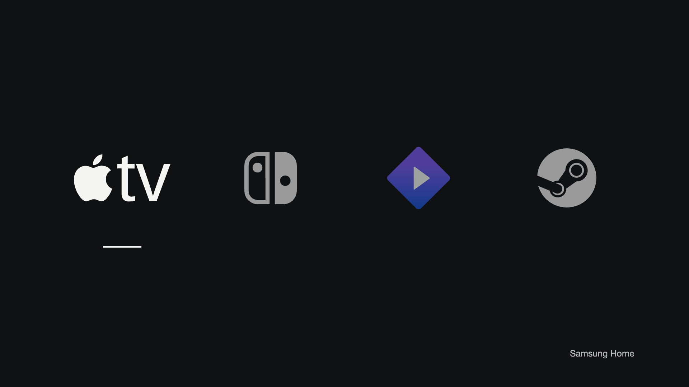

# Four

A small, offline Samsung TV dashboard for Apple TV over HDMI, Nintendo Switch 2,
Stremio, and Steam over HDMI. Built for a QN65Q70TAFXZC running Tizen 5.5.0.

**Status: experimental, tested on one TV.** Version 0.2.2 is installed.
The owner confirmed that the Samsung remote's short Home press opens Four without
Samsung's Home bar. The Home route survived one long-Power restart. Automatic
startup into Four did not work in that trial.
There is no measured performance improvement or Samsung package-removal claim.

See [Home routing and recovery](docs/home-route.md) and the
[Android-to-Samsung cleanup comparison](docs/debloat.md) before installing.
The owner tested Home, navigation, and opening Apple TV on version 0.2.2 and
reported that it felt very fast. It includes independent input discovery and
[optional local startup measurements](docs/performance.md). Other input and
recovery checks remain open; this is not a measured before/after speedup.



Browser preview of the deployed interface. This image is not a TV capture.

The four logo buttons use public Tizen APIs. Samsung Home remains an explicit
destination. There are no runtime dependencies,
network permissions, background services, polling loops, or animations.

This TV's public source API returns HDMI port numbers without the saved names.
The packaging tool imports a private export of those names. The owner does not
assign ports in the app. This is an installation snapshot: refresh it after
moving cables or renaming inputs. Other models and firmware are not verified.
The export was obtained through an undocumented developer interface; this
project does not yet provide a supported end-to-end discovery tool.

```sh
python3 -m http.server 4796 --bind 127.0.0.1 --directory app
node --test tests/*.test.cjs
python3 -m unittest discover -s tests -p 'test_*.py' -v
```

Open the local preview and use arrows, Enter, and Escape. A browser preview cannot
switch a TV input or launch a TV app. Source discovery and physical remote behavior
still require real-device checks. The Apple TV remote's Home button may be handled
by the Apple TV itself; do not assume it invokes Samsung's Home route.

Use Samsung's official certificate tools to create an owner-controlled TV Public
certificate profile containing the target TV's DUID. Keep that profile, private
keys, passwords, and device records outside Git. Package and sign the contents of
`app/` with Tizen CLI. After `tizen build-web -- app`, import the source names
into the build output, then sign that directory:

```sh
python3 tools/import-inputs.py \
  .local/tv-input-names.json app/.buildResult/input-map.js \
  --model QN65Q70TAFXZC --firmware T-NKMAKUC-2743.0
```

The private JSON export is an array of native source records with `EditName`,
`DetectedName`, and `SourceType`. The importer requires one unambiguous match
per HDMI destination. The tracked `app/input-map.js` contains no owner bindings.
Never commit generated packages, source exports, signing profiles or device IDs.

The current application identity is `Q70Home001.Home`.
Check that it does not collide with an installed app before deployment.

The dashboard alone does not replace the physical Home button. The separate
source-built [native companion](native/Route.cs) and
[offline package builder](tools/home-route.py) implement the tested Q70T route.
They use an undocumented Samsung manifest extension and require an independently
captured baseline, the exact supported firmware, and tested recovery. The builder
does not connect to a TV. A supported baseline collector is not yet provided.

No root method, uninstall tool, service modification, background Home watcher or
network feature is included. Keep the signed stock-restore package. Never
uninstall an active Home-route carrier.

This project is separate from cleanyourtv's Android launcher. Any upstream PR must
report only verified device results. Do not publish private device baselines.

Licensed under MIT. Device and service names identify the owner's destinations;
this project has no affiliation with Samsung, Apple, Nintendo, Stremio, or Valve.
